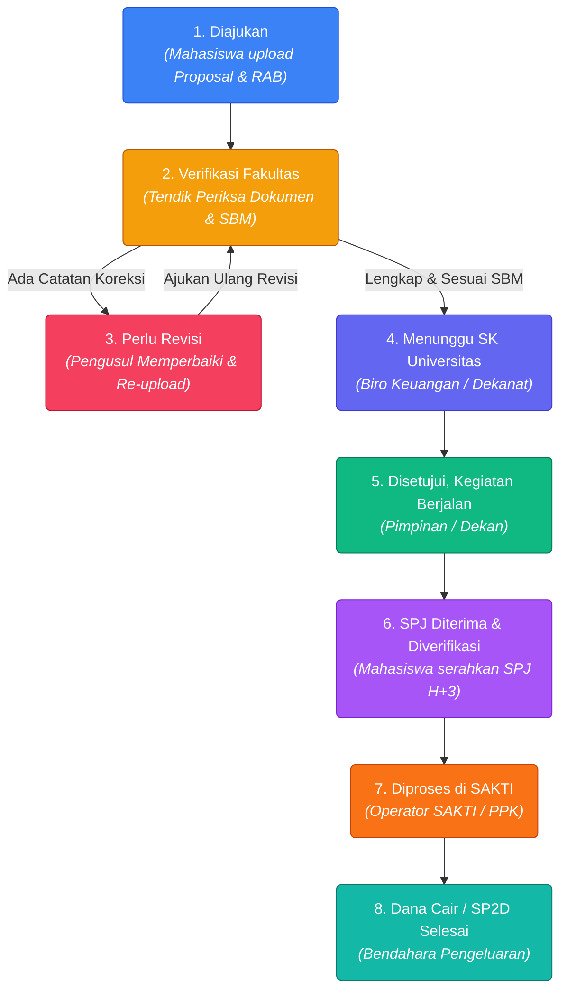

<div align="center">

# 🏛️ SAK ITK — Financial Document Status Tracking System
### *Sistem Informasi Pelacakan & Transparansi Status Dokumen Pengajuan Anggaran SAK[](https://github.com/RayhanIIqbal13/rancang-status-dokumen/actions)
[](https://github.com/RayhanIIqbal13/rancang-status-dokumen/actions)
[](https://laravel.com)
[](https://react.dev)
[](https://inertiajs.com)
[](https://www.typescriptlang.org)
[](https://tailwindcss.com)
[](LICENSE)

<br/>

**SAK ITK Document Status Tracking System** adalah platform web modern untuk manajemen, pelacakan real-time, dan audit transparan alur dokumen pengajuan anggaran kegiatan di lingkungan kampus **Institut Teknologi Kalimantan (ITK)**. 

Dirancang untuk mengeliminasi ketidakpastian *"black box"* administrasi manual dengan menghadirkan **Siklus Transparansi 8 Tahap**, validasi kepatuhan **Standar Biaya Masukan (SBM) Kemenkeu**, preview PDF Proposal & RAB interaktif bagi verifikator Tendik, manajemen direktori pengguna terpusat, rekonsiliasi SPJ pasca-kegiatan (H+3), serta integrasi alur pencairan dana aplikasi **SAKTI**.

[Fitur Utama](#-fitur-utama) • [Siklus 8 Tahap](#-siklus-alur-8-tahap-dokumen) • [Arsitektur](#-arsitektur--teknologi) • [Akun Demo](#-akun-demo-untuk-pengujian) • [Instalasi](#-panduan-instalasi--menjalankan-aplikasi) • [Pengujian](#-otomatisasi-pengujian--kualitas-kode)

</div>

---

## 🌟 Highlight Masalah & Solusi

| Masalah Administrasi Konvensional | Solusi Cerdas SAK ITK |
| :--- | :--- |
| **Berkas Fisik Sulit Dilacak:** Pengusul tidak tahu di meja siapa berkas proposal mereka berhenti. | **Pelacakan Posisi Berkas Real-time:** Menampilkan secara transparan instansi/unit pemegang berkas dan riwayat audit trail setiap detik. |
| **Revisi Berulang Tanpa Catatan Jelas:** Catatan koreksi lisan/kertas sering hilang dan membingungkan. | **Revision Loop & Historical Notes:** Notifikasi revisi otomatis dengan daftar poin perbaikan terpusat dari verifikator dan unggah ulang berkas proposal perbaikan. |
| **Verifikator Tidak Dapat Membaca Berkas Proposal:** Staf harus meminta berkas manual sebelum verifikasi. | **Preview PDF Proposal & RAB Interaktif:** Modal peninjauan dokumen PDF langsung di halaman verifikasi dan dialog disposisi sebelum mengambil keputusan. |
| **Pelanggaran Batas Pagu & Tarif SBM:** Pengusulan honor/akomodasi kerap melebihi standar pemerintah. | **Validasi SBM Kemenkeu Otomatis:** Sistem mengecek kesesuaian plafon honor narasumber, konsumsi (mis. batas Rp40.000), dan transport secara sistemik. |
| **Ketidakjelasan Alur Dokumen:** Berkas SPJ sering tertukar diunggah di awal sebelum kegiatan berlangsung. | **Alur Dokumen Berurutan Sesuai SOP:** Proposal & RAB PNBP di awal sebelum kegiatan, SPJ/LPJ diunggah pasca kegiatan (batas H+3). |
| **Pemisahan Peran yang Membingungkan:** Staf verifikator tercampur dengan administrator teknis. | **RBAC Terpisah & Live Demo Switcher:** Pemisahan tegas Mahasiswa (Pengusul), Tendik (Staf Keuangan Verifikator), dan Administrator Sistem dengan sakelar 1-klik untuk presentasi. |
| **Registrasi Akun Manual & Kaku:** Penambahan pengguna harus lewat database langsung. | **Direktori Pengguna Mandiri:** Registrasi pengguna baru dengan pemetaan peran, toggle show/hide password, dan konfirmasi kata sandi aman. |

---

## 🔄 Siklus Alur 8 Tahap Dokumen

Sistem menerapkan mesin alur kerja (*workflow state machine*) 8 tahap berurutan sesuai tata kelola standar keuangan universitas:



### Rincian Metadata & Tanggung Jawab Tahap

| No | Tahap Status | Aktor Penanggung Jawab | Default Posisi Berkas | Deskripsi Operasional |
| :---: | :--- | :--- | :--- | :--- |
| **1** | **Diajukan** | Mahasiswa / Pengusul | Subbag Keuangan Fakultas | Proposal kegiatan dan rincian usulan RAB (PNBP/BOPTN) diunggah dalam format PDF. |
| **2** | **Verifikasi Fakultas** | Tendik (Staf Keuangan) | Subbag Keuangan Fakultas | Tendik membuka PDF proposal, memeriksa kelengkapan & validasi batas SBM (misal konsumsi). |
| **3** | **Perlu Revisi** | Tendik & Pengusul | Pengusul | Berkas dikembalikan dengan catatan perbaikan resmi; mahasiswa mengunggah revisi proposal. |
| **4** | **Menunggu SK** | Tendik / Subbag Keuangan | Biro Perencanaan & Keuangan | Berkas diteruskan untuk penerbitan SK Rektor / Keputusan Dekan FSTI. |
| **5** | **Disetujui** | Pimpinan (Dekan / Wadek) | Pelaksana Kegiatan / Pengusul | SK terbit dan alokasi disetujui; mahasiswa dapat mengeksekusi kegiatan. |
| **6** | **SPJ Diverifikasi** | Mahasiswa & Tendik | Subbag Keuangan Fakultas | Pasca kegiatan (maks. H+3), mahasiswa menyerahkan berkas SPJ/LPJ untuk divalidasi. |
| **7** | **Diproses di SAKTI** | Tendik / Operator | PPK / BPP (Operator SAKTI) | Dokumen dicatat ke aplikasi SAKTI Kemenkeu untuk penerbitan SPP/SPM. |
| **8** | **Dana Cair** | Bendahara Pengeluaran | Selesai (Bendahara) | SP2D terbit, dana ditransfer ke rekening pengusul, siklus tuntas. |

---

## ⚡ Fitur Utama

- 📋 **Pengajuan Usulan Proposal & RAB Online (Mahasiswa):** Formulir interaktif dengan unggah berkas PDF terverifikasi (drag & drop, kapasitas hingga 25 MB, multipart FormData aman), pagu PNBP/BOPTN, serta kalkulasi otomatis.
- 👁️ **Preview & Tinjau Berkas PDF Proposal & RAB (Tendik & Admin):**
  - Modal peninjauan berkas PDF langsung dalam aplikasi (*inline iframe* & buka tab baru).
  - Terintegrasi langsung pada antrean daftar verifikasi (`/verifikasi-dokumen`) dan di dalam dialog modal pengambilan keputusan status (*Setuju / Revisi / Tolak*).
  - Verifikator dapat memeriksa rincian item belanja (seperti konsumsi, honor narasumber) terhadap batas SBM sebelum menyetujui atau meminta revisi.
- 🧭 **Dedicated Status Tracking & Timeline:** Halaman khusus pelacakan audit trail per dokumen dengan stepper visual, riwayat tanggal/jam, nama petugas pengubah status, dan catatan rinci.
- 📐 **Standar Biaya Masukan (SBM) Compliance Engine:** Acuan biaya standar pemerintah (honor, konsumsi, transport) dan notifikasi peringatan jika melebihi plafon.
- 🔁 **Workflow Interaktif & Unggah Ulang Berkas Revisi:** Fitur bagi pengusul untuk memperbarui berkas PDF proposal saat status berstatus *Perlu Revisi*.
- 🔀 **Live Role Switcher Bar (Demo Mode):** Dropdown sakelar peran di header aplikasi untuk beralih instan antara Mahasiswa, Tendik (Verifikator), Admin, dan Pimpinan tanpa perlu logout/login ulang saat simulasi.
- 👥 **Direktori & Manajemen Pengguna (User Management):** Pendaftaran akun baru, pemetaan peran, toggle show/hide password, dan konfirmasi kata sandi.
- 🔍 **Command Palette & Global Search (`Ctrl + K`):** Pencarian instan proposal, anggaran, dan SBM langsung dari keyboard.
- 🖨️ **Format Cetak Laporan Resmi (Print-Ready):** Format cetak dokumen resmi universitas.
- 📊 **Executive Dashboard Analytics:** KPI analitik pengajuan dan grafik tren anggaran interaktif.

---

## 👥 Akun Demo untuk Pengujian (Simulasi Capstone)

Database seeder telah dilengkapi akun representatif untuk pengujian alur simulasi Capstone Project FSTI ITK:

> **Password default untuk semua akun demo:** `password`

| Peran (Role) | Email | Nama Pengguna / Identitas | Hak Akses Utama |
| :--- | :--- | :--- | :--- |
| **Mahasiswa (Pengusul)** | `mahasiswa@itk.ac.id` | **Raihan Iqbal**<br/>*(NIM 10211068 - S1 SI FSTI)* | Input data kegiatan, upload Proposal & RAB (PDF), pantau status tracking, ajukan perbaikan revisi. |
| **Tendik (Verifikator FSTI)** | `tendik@itk.ac.id` | **Dwitami, S.E.**<br/>*(NIP 199304122019032014 - Keuangan FSTI)* | Antrean verifikasi dokumen, **preview PDF Proposal & RAB**, validasi SBM, beri catatan revisi / persetujuan. |
| **Administrator Sistem** | `admin@itk.ac.id` | **Administrator SAK ITK** | Akses penuh manajemen pengguna, data master SBM, pengaturan sistem, dan preview berkas. |
| **Pimpinan (Dekan)** | `pimpinan@itk.ac.id` | **Prof. Dr. Ir. Dekan FSTI ITK** | Memberikan persetujuan akhir (*Disetujui, Kegiatan Berjalan*), monitoring dashboard eksekutif. |

> 💡 **Tips Simulasi:** Gunakan menu **"Ganti Peran Demo"** pada header pojok kanan atas untuk berpindah aktor (*Mahasiswa ↔ Tendik ↔ Admin*) secara instan dengan satu kali klik.

---

## 🚀 Panduan Instalasi & Menjalankan Aplikasi

### 1. Prasyarat Sistem
Pastikan komputer Anda telah terinstal:
- **PHP** >= 8.2 (dengan ekstensi `pdo_sqlite`, `curl`, `mbstring`, `fileinfo`)
- **Composer** >= 2.6
- **Node.js** >= 20.x dan **npm** >= 10.x
- **Git**

### 2. Kloning Repositori
```bash
git clone https://github.com/RayhanIIqbal13/rancang-status-dokumen.git
cd rancang-status-dokumen
```

### 3. Instal Dependensi Backend & Frontend
```bash
# Instal dependensi PHP
composer install

# Instal dependensi JavaScript / React
npm install
```

### 4. Konfigurasi Environment & Database
```bash
# Salin file konfigurasi environment
cp .env.example .env

# Generate Application Key
php artisan key:generate

# Buat berkas database SQLite (atau sesuaikan .env jika menggunakan MySQL)
touch database/database.sqlite

# Jalankan migrasi dan seeder data simulasi
php artisan migrate:fresh --seed
```

### 5. Menjalankan Server Pengembangan
Anda dapat menjalankan server aplikasi dan aset Vite secara bersamaan dengan satu perintah:

```bash
composer run dev
```

Or jalankan di terminal terpisah:
```bash
# Terminal 1: Laravel Backend Server
php artisan serve

# Terminal 2: Vite Development Server
npm run dev
```

Buka peramban Anda di: **`http://127.0.0.1:8000`**

---

## 🧪 Otomatisasi Pengujian & Kualitas Kode

Proyek ini menerapkan standar Continuous Integration (CI) yang ketat melalui **GitHub Actions** untuk menjamin kestabilan kode:

```bash
# Menjalankan seluruh test suite Pest (43 Tests, 196 Assertions - PASS 100%)
php artisan test

# Memeriksa dan merapikan style kode PHP dengan Laravel Pint
./vendor/bin/pint --test
./vendor/bin/pint

# Memeriksa static analysis kode TypeScript & React dengan ESLint
npm run lint

# Memeriksa kerapian format berkas frontend dengan Prettier
npm run format:check
npm run format

# Menguji build bundle aset produksi Vite
npm run build
```

---

## 📂 Struktur Direktori Proyek

```plaintext
rancang-status-dokumen/
├── app/
│   ├── Enums/                     # State Machine: DocumentStatus & UserRole
│   ├── Http/Controllers/          # RESTful Controllers (Dokumen, Pengguna, SBM, Realisasi)
│   ├── Models/                    # DokumenPengajuan, StatusTracking, StandarBiaya, BuktiPengeluaran, User
│   └── Services/                  # DashboardAnalyticsService (KPI & Recharts processor)
├── config/
│   └── inertia.php                # Konfigurasi testing view paths Inertia (Cross-platform CI)
├── database/
│   ├── migrations/                # Skema tabel pengajuan, tracking, SBM, dan realisasi
│   └── seeders/                   # DokumenTrackingSeeder (Skenario simulasi 8 tahap)
├── resources/
│   ├── css/                       # Tailwind CSS v4 stylesheets
│   └── js/
│       ├── components/            # Komponen modular: timeline, stepper, dialog update status, badge, command palette
│       ├── hooks/                 # Custom React hooks (use-preferences, use-mobile, use-clipboard)
│       ├── layouts/               # Shell layout autentikasi dan dashboard
│       ├── pages/                 # Inertia React Pages (dashboard, dokumen, status-tracking, pengguna, dll.)
│       └── types/                 # TypeScript typings & interfaces
├── routes/
│   ├── web.php                    # Rute utama aplikasi SAK ITK (Dokumen, Pengguna CRUD, Laporan, SBM)
│   └── auth.php                   # Rute autentikasi
└── tests/
    └── Feature/
        ├── DokumenStatusTrackingTest.php  # Test suite lengkap alur 8 tahap, SBM, SAKTI, & User Management
        └── DashboardTest.php              # Test suite dasbor analitik
```

---

## 📄 Lisensi & Kontribusi

Proyek ini dikembangkan di bawah lisensi open-source **[MIT License](LICENSE)**. Kontribusi berupa bug report, saran perbaikan alur, maupun pull request sangat disambut baik.

<div align="center">
  <sub>Dikembangkan dengan dedikasi untuk efisiensi tata kelola administrasi keuangan kampus yang transparan dan akuntabel.</sub><br/>
  <b>Institut Teknologi Kalimantan © 2026</b>
</div>