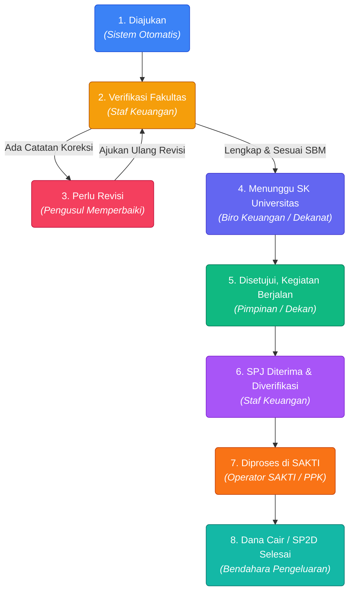
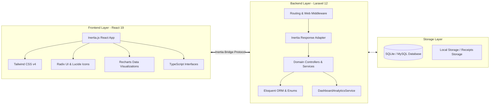

<div align="center">

# 🏛️ SAK ITK — Financial Document Status Tracking System
### *Sistem Informasi Pelacakan & Transparansi Status Dokumen Pengajuan Anggaran SAK ITK*

[](https://github.com/RayhanIIqbal13/rancang-status-dokumen/actions)
[](https://github.com/RayhanIIqbal13/rancang-status-dokumen/actions)
[](https://laravel.com)
[](https://react.dev)
[](https://inertiajs.com)
[](https://www.typescriptlang.org)
[](https://tailwindcss.com)
[](LICENSE)

<br/>

**SAK ITK Document Status Tracking System** adalah platform web modern untuk manajemen, pelacakan real-time, dan audit transparan alur dokumen pengajuan anggaran kegiatan di lingkungan kampus **Institut Teknologi Kalimantan (ITK)**. 

Dirancang untuk mengeliminasi ketidakpastian *"black box"* administrasi manual dengan menghadirkan **Siklus Transparansi 8 Tahap**, validasi kepatuhan **Standar Biaya Masukan (SBM) Kemenkeu**, manajemen direktori pengguna terpusat, rekonsiliasi SPJ, serta integrasi alur pencairan dana aplikasi **SAKTI**.

[Fitur Utama](#-fitur-utama) • [Siklus 8 Tahap](#-siklus-alur-8-tahap-dokumen) • [Arsitektur](#-arsitektur--teknologi) • [Akun Demo](#-akun-demo-untuk-pengujian) • [Instalasi](#-panduan-instalasi--menjalankan-aplikasi) • [Pengujian](#-otomatisasi-pengujian--kualitas-kode)

</div>

---

## 🌟 Highlight Masalah & Solusi

| Masalah Administrasi Konvensional | Solusi Cerdas SAK ITK |
| :--- | :--- |
| **Berkas Fisik Sulit Dilacak:** Pengusul tidak tahu di meja siapa berkas proposal mereka berhenti. | **Pelacakan Posisi Berkas Real-time:** Menampilkan secara transparan instansi/unit pemegang berkas dan riwayat audit trail setiap detik. |
| **Revisi Berulang Tanpa Catatan Jelas:** Catatan koreksi lisan/kertas sering hilang dan membingungkan. | **Revision Loop & Historical Notes:** Notifikasi revisi otomatis dengan daftar poin perbaikan terpusat dari verifikator. |
| **Pelanggaran Batas Pagu & Tarif SBM:** Pengusulan honor/akomodasi kerap melebihi standar pemerintah. | **Validasi SBM Kemenkeu Otomatis:** Sistem mengecek kesesuaian plafon honor narasumber, konsumsi, dan transport secara sistemik. |
| **Keterlambatan SPJ & Pencairan SAKTI:** Rekapitulasi bukti kuitansi terpisah dari sistem pencairan dana. | **Siklus SPJ Terpadu hingga Dana Cair:** Modul unggah bukti digital, approval pimpinan, integrasi status SAKTI, dan pencairan SP2D. |
| **Registrasi Akun Manual & Kaku:** Penambahan pengguna harus lewat database langsung. | **Direktori Pengguna Mandiri:** Registrasi pengguna baru dengan pemetaan peran, toggle show/hide password, dan konfirmasi kata sandi aman. |

---

## 🔄 Siklus Alur 8 Tahap Dokumen

Sistem menerapkan mesin alur kerja (*workflow state machine*) 8 tahap berurutan sesuai tata kelola standar keuangan universitas:



### Rincian Metadata & Tanggung Jawab Tahap

| No | Tahap Status | Aktor Penanggung Jawab | Default Posisi Berkas | Deskripsi Operasional |
| :---: | :--- | :--- | :--- | :--- |
| **1** | **Diajukan** | Sistem (Otomatis) | Subbag Keuangan Fakultas | Proposal kegiatan dan rincian usulan anggaran didaftarkan oleh pengusul. |
| **2** | **Verifikasi Fakultas** | Staf Keuangan | Subbag Keuangan Fakultas | Staf memeriksa kelengkapan administrasi dan validasi kepatuhan tarif SBM. |
| **3** | **Perlu Revisi** | Staf Keuangan & Pengusul | Pengusul | Berkas dikembalikan dengan catatan perbaikan resmi untuk diajukan ulang. |
| **4** | **Menunggu SK** | Staf Keuangan | Biro Perencanaan & Keuangan | Berkas diteruskan untuk penerbitan SK Rektor / Keputusan Dekan. |
| **5** | **Disetujui** | Pimpinan (Dekan / Wadek) | Pelaksana Kegiatan / Pengusul | SK terbit dan alokasi disetujui; pengusul dapat mengeksekusi kegiatan. |
| **6** | **SPJ Diverifikasi** | Staf Keuangan | Subbag Keuangan Fakultas | Pengusul menyerahkan berkas SPJ; bukti transaksi fisik & digital divalidasi. |
| **7** | **Diproses di SAKTI** | Staf Keuangan / Operator | PPK / BPP (Operator SAKTI) | Dokumen dicatat ke aplikasi SAKTI Kemenkeu untuk penerbitan SPP/SPM. |
| **8** | **Dana Cair** | Staf Keuangan | Selesai (Bendahara) | SP2D terbit, dana ditransfer ke rekening pengusul, siklus tuntas. |

---

## ⚡ Fitur Utama

- 📋 **Pengajuan Usulan Proposal Online:** Formulir interaktif dengan kalkulasi otomatis total usulan pagu belanja (BOPTN, PNBP, RKA-K/L, Hibah Pengabdian, dll).
- 🧭 **Dedicated Status Tracking & Timeline:** Halaman khusus pelacakan audit trail per dokumen dengan stepper visual, riwayat tanggal/jam, nama petugas pengubah status, dan catatan rinci.
- 📐 **Standar Biaya Masukan (SBM) Compliance Engine:** Katalog acuan biaya standar pemerintah (Honor narasumber, paket meeting, konsumsi, akomodasi, transportasi) beserta validasi kepatuhan transaksi.
- 🔁 **Workflow Interaktif & Modal Update Status:** Dialog modal bagi staf keuangan dan pimpinan untuk mengubah status, memilih posisi berkas berikutnya, dan memasukkan catatan disposisi.
- 🧾 **Manajemen Bukti Pengeluaran & Realisasi Anggaran:** Pencatatan kuitansi/faktur, kelengkapan fisik, persentase serapan anggaran, dan tanggal pencairan SP2D.
- 👥 **Direktori & Manajemen Pengguna (User Management):**
  - **Pendaftaran Akun Baru:** Modal pendaftaran dengan form nama, email universitas, NIP/NIDN/NIM, unit kerja, serta penetapan hak akses peran (*Pengusul, Staf Keuangan, Pimpinan, Administrator*).
  - **Verifikasi Sandi Ganda:** Kolom *Kata Sandi* & *Konfirmasi Kata Sandi* dilengkapi indikator kecocokan real-time.
  - **Toggle Mata (Show/Hide Password):** Kemudahan melihat/menyembunyikan kata sandi dengan ikon interaktif.
  - **Default Password Helper:** Pendaftaran cepat dengan kata sandi bawaan `password` yang dapat diganti sewaktu-waktu.
  - **Edit & Hapus Pengguna:** Perbaruan data akun serta perlindungan protektif agar pengguna tidak dapat menghapus akunnya sendiri.
- 🔍 **Command Palette & Global Search (`Ctrl + K` / `Cmd + K`):** Pencarian instan dokumen pengajuan, pagu anggaran, nomor proposal, dan katalog SBM langsung dari keyboard.
- 🖨️ **Format Cetak Laporan Resmi (Print-Ready):** Tampilan cetak laporan dokumen pengajuan dan realisasi anggaran berstandar dokumen resmi universitas (otomatis membersihkan navigasi dan sidebar saat dicetak).
- ⚙️ **Panel Pengaturan Tampilan (Preferences):** Kustomisasi varian sidebar (*inset* atau *sidebar*), mode runtuh (*collapsible*), dan tata letak konten (*centered* atau *full-width*).
- 📊 **Executive Dashboard Analytics:**
  - Ringkasan KPI: Total usulan, total realisasi cair, dokumen aktif menunggu tindakan, dan status perlu revisi.
  - Grafik tren pengajuan vs pencairan interaktif berbasis **Recharts** dengan filter rentang waktu (1 bulan, 3 bulan, semester).
- 🔐 **Role-Based Access Control (RBAC):** Proteksi hak akses bertingkat untuk **Pengusul**, **Staf Keuangan**, **Pimpinan**, dan **Admin Keuangan Pusat**.
- 🌓 **Desain Modern & Responsif:** Menggunakan Tailwind CSS v4, Radix UI Primitives, Lucide Icons, serta tema light/dark mode yang elegan.

---

## 🛠️ Arsitektur & Teknologi

Sistem dibangun dengan arsitektur modern **Hybrid Monolith SPA** menggunakan Laravel dan React yang dihubungkan secara mulus oleh Inertia.js v2 tanpa latensi routing API terpisah:



### Rincian Stack Teknologi

* **Backend Framework:** [Laravel 12](https://laravel.com) (PHP 8.2+)
* **Single Page App Protocol:** [Inertia.js v2](https://inertiajs.com)
* **Frontend Library:** [React 19](https://react.dev) + [TypeScript](https://www.typescriptlang.org)
* **Styling & Design System:** [Tailwind CSS v4](https://tailwindcss.com) + [Radix UI](https://www.radix-ui.com)
* **Charts & Visualisasi Data:** [Recharts 3.x](https://recharts.org)
* **Icon Set:** [Lucide React](https://lucide.dev)
* **Pustaka Form & Routing:** Inertia Form Helpers + Ziggy Route Helper
* **Testing Framework:** [Pest PHP 3.8](https://pestphp.com) + Inertia Testing Finder (40 Tests, 176 Assertions)
* **Code Formatter & Linter:** [Laravel Pint](https://laravel.com/docs/pint), [ESLint 9](https://eslint.org), [Prettier](https://prettier.io)

---

## 👥 Akun Demo untuk Pengujian

Database seeder telah dilengkapi dengan akun representatif dan data pengajuan realistis untuk seluruh peran:

> **Password default untuk semua akun demo:** `password`

| Peran (Role) | Email | Nama Pengguna | Hak Akses Utama |
| :--- | :--- | :--- | :--- |
| **Pengusul (Dosen/Unit)** | `pengusul@univ.ac.id` | Dr. Ahmad Hidayat, M.Kom. | Membuat proposal baru, memantau berkas sendiri, mengajukan revisi. |
| **Pengusul (Fakultas Lain)** | `dosen.teknik@univ.ac.id` | Dr. Eng. Siti Nurhaliza, S.T. | Mengelola proposal kegiatan jurusan Teknik Elektro. |
| **Staf Keuangan** | `stafkeuangan@univ.ac.id` | Siti Rahmawati, S.E. | Verifikasi proposal, minta revisi, validasi SBM, input SPJ, proses SAKTI, catat pencairan. |
| **Pimpinan (Dekan)** | `pimpinan@univ.ac.id` | Prof. Dr. Ir. Bambang Sutrisno | Memberikan persetujuan resmi (*Disetujui, Kegiatan Berjalan*), melihat laporan eksekutif. |
| **Administrator Pusat** | `admin@univ.ac.id` | Administrator Keuangan Pusat | Akses penuh direktori pengguna (tambah/edit/hapus), data master SBM, dan seluruh laporan universitas. |

---

## 🚀 Panduan Instalasi & Menjalankan Aplikasi

### 1. Prasyarat Sistem
Pastikan komputer Anda telah terinstal:
- **PHP** >= 8.2 (dengan ekstensi `pdo_sqlite`, `curl`, `mbstring`, `fileinfo`)
- **Composer** >= 2.6
- **Node.js** >= 20.x dan **npm** >= 10.x
- **Git**

### 2. Kloning Repositori
```bash
git clone https://github.com/RayhanIIqbal13/rancang-status-dokumen.git
cd rancang-status-dokumen
```

### 3. Instal Dependensi Backend & Frontend
```bash
# Instal dependensi PHP
composer install

# Instal dependensi JavaScript / React
npm install
```

### 4. Konfigurasi Environment & Database
```bash
# Salin file konfigurasi environment
cp .env.example .env

# Generate Application Key
php artisan key:generate

# Buat berkas database SQLite (atau sesuaikan .env jika menggunakan MySQL)
touch database/database.sqlite

# Jalankan migrasi dan seeder data simulasi
php artisan migrate:fresh --seed
```

### 5. Menjalankan Server Pengembangan
Anda dapat menjalankan server aplikasi dan aset Vite secara bersamaan dengan satu perintah:

```bash
composer run dev
```

Atau jalankan di terminal terpisah:
```bash
# Terminal 1: Laravel Backend Server
php artisan serve

# Terminal 2: Vite Development Server
npm run dev
```

Buka peramban Anda di: **`http://127.0.0.1:8000`**

---

## 🧪 Otomatisasi Pengujian & Kualitas Kode

Proyek ini menerapkan standar Continuous Integration (CI) yang ketat melalui **GitHub Actions** untuk menjamin kestabilan kode:

```bash
# Menjalankan seluruh test suite Pest (40 Tests, 176 Assertions - PASS 100%)
php artisan test

# Memeriksa dan merapikan style kode PHP dengan Laravel Pint
./vendor/bin/pint --test
./vendor/bin/pint

# Memeriksa static analysis kode TypeScript & React dengan ESLint
npm run lint

# Memeriksa kerapian format berkas frontend dengan Prettier
npm run format:check
npm run format

# Menguji build bundle aset produksi Vite
npm run build
```

---

## 📂 Struktur Direktori Proyek

```plaintext
rancang-status-dokumen/
├── app/
│   ├── Enums/                     # State Machine: DocumentStatus & UserRole
│   ├── Http/Controllers/          # RESTful Controllers (Dokumen, Pengguna, SBM, Realisasi)
│   ├── Models/                    # DokumenPengajuan, StatusTracking, StandarBiaya, BuktiPengeluaran, User
│   └── Services/                  # DashboardAnalyticsService (KPI & Recharts processor)
├── config/
│   └── inertia.php                # Konfigurasi testing view paths Inertia (Cross-platform CI)
├── database/
│   ├── migrations/                # Skema tabel pengajuan, tracking, SBM, dan realisasi
│   └── seeders/                   # DokumenTrackingSeeder (Skenario simulasi 8 tahap)
├── resources/
│   ├── css/                       # Tailwind CSS v4 stylesheets
│   └── js/
│       ├── components/            # Komponen modular: timeline, stepper, dialog update status, badge, command palette
│       ├── hooks/                 # Custom React hooks (use-preferences, use-mobile, use-clipboard)
│       ├── layouts/               # Shell layout autentikasi dan dashboard
│       ├── pages/                 # Inertia React Pages (dashboard, dokumen, status-tracking, pengguna, dll.)
│       └── types/                 # TypeScript typings & interfaces
├── routes/
│   ├── web.php                    # Rute utama aplikasi SAK ITK (Dokumen, Pengguna CRUD, Laporan, SBM)
│   └── auth.php                   # Rute autentikasi
└── tests/
    └── Feature/
        ├── DokumenStatusTrackingTest.php  # Test suite lengkap alur 8 tahap, SBM, SAKTI, & User Management
        └── DashboardTest.php              # Test suite dasbor analitik
```

---

## 📄 Lisensi & Kontribusi

Proyek ini dikembangkan di bawah lisensi open-source **[MIT License](LICENSE)**. Kontribusi berupa bug report, saran perbaikan alur, maupun pull request sangat disambut baik.

<div align="center">
  <sub>Dikembangkan dengan dedikasi untuk efisiensi tata kelola administrasi keuangan kampus yang transparan dan akuntabel.</sub><br/>
  <b>Institut Teknologi Kalimantan © 2026</b>
</div>